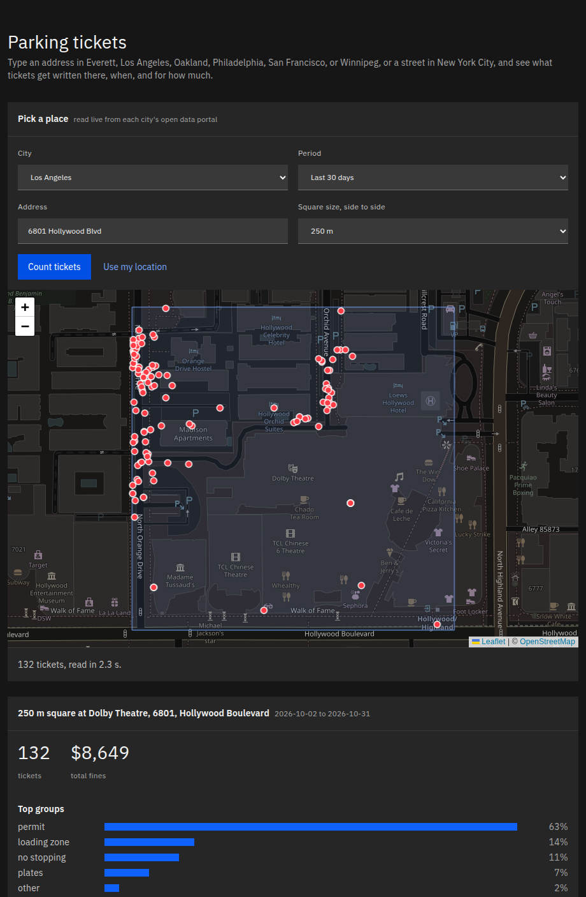

# parking-tickets

Parking tickets from many US and Canadian cities in one table: same columns, same violation groups, read straight from each city's open-data portal.

[](https://ivanvia7.github.io/parking-tickets/)

Today: Los Angeles, New York City, San Francisco, Philadelphia, Oakland, Winnipeg and Everett WA, over 245 million tickets. See [CITIES.md](CITIES.md) for row counts, dates and source links.

```
$ parking-tickets fetch --city la,sf,nyc --since 2025-06-03 --until 2025-06-03
$ parking-tickets stats
la: 7886 rows, 2025-06-03 to 2025-06-03, 99.9% with lat/lon, 3.8% in other
nyc: 53907 rows, 2025-06-03 to 2025-06-03, 0.0% with lat/lon, 2.6% in other
sf: 5158 rows, 2025-06-03 to 2025-06-03, 98.3% with lat/lon, 3.4% in other
```

## Three ways in

**Notebook**

```python
from parking_tickets import load

df = load("la", since="2025-06-01", until="2025-06-30")
df.groupby("group")["fine_usd"].sum()
```

Install with `pip install "parking-tickets[pandas]"`. Days already read come from the local cache, so the second call is instant.

**Command line**

```
pip install parking-tickets
parking-tickets fetch --city la,sf --since 2025-06-01 --until 2025-06-30 --out tickets.csv
parking-tickets stats
```

`--out` writes `.csv`, `.jsonl`, `.db` (SQLite) or `.parquet` (needs `pip install "parking-tickets[parquet]"`).

**No code**

Ready Parquet and gzipped CSV files (`.csv.gz`), one per city and year, are on the [Releases page](https://github.com/ivanvia7/parking-tickets/releases) (`data-YYYY-MM`), refreshed monthly. `MANIFEST.json` in each release lists every file with its row count and SHA-256.

## One row per ticket

| Column | Meaning |
|---|---|
| `city` | slug: `la`, `nyc`, `sf`, `philadelphia`, `oakland`, `winnipeg`, `everett` |
| `source_id` | the city's own ticket number; unique together with `city` |
| `issued_at` | local time, ISO 8601; date only when the city's time is unreadable |
| `violation_code` | the city's code as given |
| `violation_text` | the city's description; for New York, from its code table |
| `group` | shared group from [`groups.csv`](src/parking_tickets/groups.csv), `other` when unknown |
| `fine_usd` | fine in dollars (Canadian for Winnipeg); empty when the city does not publish it |
| `location` | address or block as given |
| `lat`, `lon` | empty when missing or outside the city limits (a geocoding error) |
| `plate_state` | two letters |

Plate numbers are never stored.

The 21 groups: `street_cleaning`, `meter`, `time_limit`, `permit`, `no_parking`, `no_stopping`, `loading_zone`, `bus_zone`, `hydrant`, `double_parking`, `driveway`, `sidewalk`, `crosswalk`, `disabled`, `registration`, `plates`, `inspection`, `bike_lane`, `speed_camera`, `red_light_camera`, `transit_fare`. In one month per city (June 2025; Philadelphia June 2017) at least 96% of tickets landed outside `other`.

## Good to know

- New York's data includes school-zone speed camera and red-light camera tickets (a third of NYC rows in June 2025); filter on `group`.
- New York publishes no coordinates; `lat` and `lon` are empty there, `location` has house number and street.
- San Francisco's data includes Muni fare evasion citations, group `transit_fare`.
- Philadelphia publishes 2012 to 2017 only and has no violation code; its groups come from the description text.
- New York fines come from the city's violation code table; tickets in Manhattan at or below 96th St get the higher fine, matched by police precinct.
- Winnipeg fines are Canadian dollars, the full fine before the early-payment discount. Its tickets have no ticket number, so `source_id` is the portal's row id, and since mid-2020 they carry the day only.
- Everett publishes no fine amounts; `fine_usd` is empty there.
- Oakland publishes about three months late.
- Days in the last 30 days are read again on every fetch, because cities keep adding late tickets.

## Commands

| Command | Does |
|---|---|
| `fetch` | read tickets into the local SQLite cache, optionally write `--out` |
| `stats` | rows, dates, share with lat/lon and share in `other`, per cached city |
| `cities` | list city slugs |
| `check-city <slug>` | read 100 live rows through the city file; fails on a missing column |

The cache lives at `~/.cache/parking-tickets/cache.db` (or under `$XDG_CACHE_HOME`). Set `SOCRATA_APP_TOKEN` for higher portal rate limits; it is optional.

## Add a city

See [CONTRIBUTING.md](CONTRIBUTING.md). A link to a city's ticket dataset is a contribution too.

## License

MIT. The data belongs to each city; see the source links in [CITIES.md](CITIES.md).
